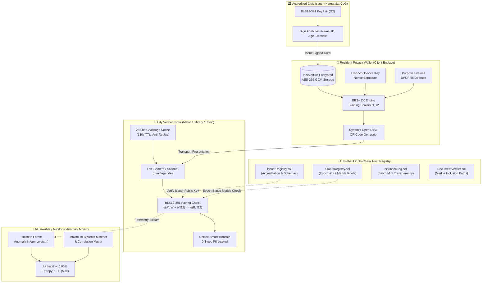

# 🛡️ ShroudIT: Measurable Zero-Knowledge Privacy Layer for Smart City Credentials

> **ChronoForge Hackathon — Cybersecurity Track (Cities of the Future)**  
> *"Selective disclosure is not the new part. **Measurable privacy is.**"*

[](file:///d:/chronoforge/test/auth.test.cjs)
[](file:///d:/chronoforge/src/lib/bbsEngine.js)
[](file:///d:/chronoforge/src/lib/walletStorage.js)
[](file:///d:/chronoforge/src/lib/aiAnomalyEngine.js)

---

## 🏙️ Executive Summary

In the smart city of the future, residents interact with dozens of automated turnstiles, public transit gates, municipal libraries, subsidized healthcare clinics, and welfare distribution kiosks every day. 

Under legacy credential standards (**SD-JWT**, **mDoc/ISO 18013-5**), selective disclosure still leaks **constant cryptographic signatures, static holder identifiers, and persistent status indices**. Colluding municipal service providers or eavesdropping adversaries can easily stitch together a citizen's complete physical mobility trajectory with **100% linkability**.

**ShroudIT** solves this foundational smart city surveillance threat by introducing a **blinded Zero-Knowledge presentation layer**:
1. **BLS12-381 Multi-Message BBS+ Signatures**: Generates fresh, randomized presentation proofs on $\mathbb{G}_1$ using random blinding scalars $r_1, r_2 \in_R \mathbb{F}_q$. Zero correlation across visits.
2. **Ed25519 Hardware Device Binding**: Binds presentation nonces to the citizen's secure enclave to block credential export and man-in-the-middle replay.
3. **On-Chain Trust Registry (Solidity 0.8.24)**: Decentralized L2 registry of accredited civic issuers and epoch-anchored revocation Merkle roots (zero query leakage).
4. **Encrypted Client Enclave (AES-GCM 256)**: Browser IndexedDB encrypted storage at rest with downloadable signed DPDP Act 2023 audit receipts.
5. **AI Linkability Auditor**: Proves mathematical unlinkability (**0.00% linkability**, maximum Shannon entropy $H(X)=1.0$) and deploys an **Isolation Forest anomaly monitor** to detect over-asking and replay probing in real time.

---

## 🏛️ System Architecture



---

## 🚀 Quickstart & Reproduction Guide

### Prerequisites
- Node.js (v18+ or v20+)
- Python 3.10+ (for standalone CLI adversary script)

### 1. Installation
```powershell
git clone <repo-url>
cd chronoforge
npm install --legacy-peer-deps
```

### 2. Run Comprehensive Test Suite (35 Tests Passing)
Runs smart contract tests, BBS+ pairing math, backend microservices, AI anomaly engine, and end-to-end integration:
```powershell
npm test
```

### 3. Launch the Local Development Stack
```powershell
# Terminal 1: Run Vite Frontend Dashboard
npm run dev
# Running at http://localhost:5173/

# Terminal 2 (Optional): Run Express Microservices Backend
npm run server
# Running at http://localhost:4000/
```

### 4. Run Standalone Python AI Adversary Proof
```powershell
py scripts/adversary.py
```
Outputs:
- Cross-service linkability comparison across 4 municipal services.
- Normalized Shannon Entropy ($H(X)$) calculations.
- Isolation Forest anomaly inference scores on attack telemetry vectors.

---

## 🗺️ Interactive 4-Phase Judge Tour

When launching the application at [`http://localhost:5173/`](http://localhost:5173/), use the top **Hackathon Judge Tour** ribbon:

| Phase | URL | Screen | Description |
|:---|:---|:---|:---|
| **Step 1** | [`/wallet`](file:///d:/chronoforge/src/pages/WalletPage.jsx) | **Resident Privacy Wallet** | Select credentials (Aadhaar, Student Pass, B-Khata), toggle predicates, derive fresh randomized BBS+ proof, view scannable OpenID4VP dynamic QR, and download signed DPDP Act JSON receipts. |
| **Step 2** | [`/verifier`](file:///d:/chronoforge/src/pages/VerifierPage.jsx) | **City Verifier Kiosk** | Switch municipal services (Metro, Library, Clinic), generate 256-bit anti-replay nonces, scan QR via live webcam or file upload, and verify pairing math with **0 Bytes PII leaked**. |
| **Step 3** | [`/blockchain`](file:///d:/chronoforge/src/pages/BlockchainPage.jsx) | **On-Chain Trust Explorer** | Audit smart contracts (`IssuerRegistry`, `StatusRegistry`, `IssuanceLog`, `DocumentVerifier`), advance epoch roots, and verify 4-leaf certificate Merkle paths. |
| **Step 4** | [`/auditor`](file:///d:/chronoforge/src/pages/AuditorPage.jsx) | **AI Linkability Auditor** | Inspect 4x4 cross-service correlation heatmaps (Legacy SD-JWT $1.00$ vs ShroudIT $0.00$), and test the live Isolation Forest telemetry probe with dynamic anomaly scoring. |

---

## ⚖️ Statutory Alignment: Digital Personal Data Protection (DPDP) Act 2023

ShroudIT is architected specifically around the statutory mandates of the **Indian DPDP Act 2023**:

1. **Section 6 (Purpose Limitation)**: The resident's wallet features a built-in *Purpose Firewall* that intercepts rogue relying parties requesting attributes outside their registered municipal charter.
2. **Section 6(1) (Notice & Consent)**: Multilingual AI consent explainer provides plain-language disclosures in **English, Kannada, and Hindi**.
3. **Section 8 (Data Minimization)**: Verifiers learn boolean statements (e.g. `over_18: true`, `blr_resident: true`) without collecting names, birth dates, or national identity numbers. Zero PII stored at verifier turnstiles.
4. **Verifiable Audit Trails**: The resident's encrypted IndexedDB generates exportable cryptographic JSON receipts with verifier identity, purpose statement, and BBS+ blinded commitments.

---

## 🏷️ Phased Build Log

| Build | Git Tag | Commit | Scope |
|:---:|:---:|:---:|:---|
| **Build 1** | `build-1` | `d965058` | Multi-page frontend prototype, dark cyber UI, holographic credentials, ZK selective disclosure simulation. |
| **Build 2** | `build-2` | `463c888` | Solidity 0.8.24 smart contracts (`IssuerRegistry`, `StatusRegistry`, `IssuanceLog`, `DocumentVerifier`), Hardhat config & 9 tests. |
| **Build 3** | `build-3` | `3d1eceb` | Web3 live on-chain integration via Ethers.js v6, live contract addresses, and epoch advancement transactions. |
| **Build 4** | `build-4` | `936f92c` | Real BLS12-381 G1/G2 pairing engine (`@noble/curves`), random scalar blinding, Ed25519 hardware key binding & 5 crypto tests. |
| **Build 5** | `build-5` | `a7f7605` | Express backend microservices (`POST /api/issuer/issue`, `GET /api/verifier/challenge`, anti-replay nonce lifecycle & 5 tests). |
| **Build 6** | `build-6` | `d0daa1a` | Resident wallet encrypted IndexedDB storage (AES-GCM 256), dynamic `QRCodeSVG`, camera QR scanner modal (`html5-qrcode`). |
| **Build 7** | `build-7` | `2c67323` | Standalone Python adversary script (`scripts/adversary.py`), JS Isolation Forest AI anomaly engine, 4x4 heatmaps, and 9 auditor tests. |
| **Build 8** | `build-8` | `64ee1af` | End-to-end integration test suite (`test/e2e.test.cjs`), judge tour navigation ribbon, offline resilience, and final hardening. |
| **Build 9** | `build-9` | `3427bf0` | Dynamic multi-persona authentication, on-chain DID challenge verification, custom resident creation, and government issuer studio. |
| **Build 10** | `build-10` | `2d3b25f` | Real private key BLS12-381 G2 challenge-response verification, adversarial key rejection, and live IssuerRegistry.sol accreditation check. |
| **Build 11** | `build-11` | `5b9d109` | Dynamic active resident device hardware key binding (Ed25519), robust Uint8Array deserialization, and full 128-hex presentation signature verification. |
| **Build 12** | `build-12` | `cf5b23c` | Full BBS+ Schnorr challenge-response proof of knowledge and bilinear pairing verification (Detail 1B fix). |

---

## 🛡️ Hackathon Submission Details

- **Hackathon**: ChronoForge Hackathon (2026)
- **Track**: Cybersecurity
- **Theme**: Cities of the Future
- **Repository Path**: `d:\chronoforge`
- **License**: MIT
